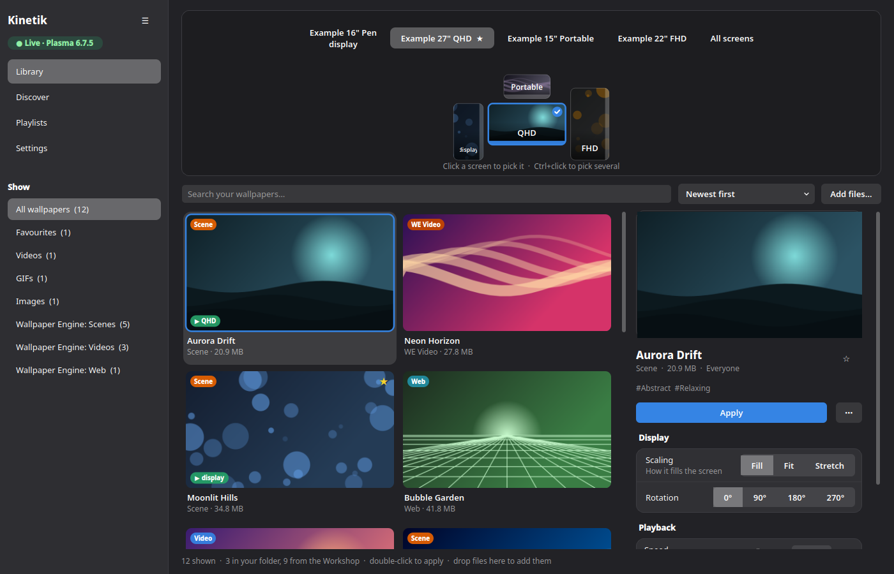

# Kinetik

**Live wallpapers for KDE Plasma 6.** Your own videos, GIFs and images, plus **Wallpaper Engine**
scenes, videos and web wallpapers from the Steam Workshop, with a built-in browser for MotionBGs,
MoeWalls and the Workshop. A Wallpaper Engine–style app for Linux, in the same style as its sibling
[Kolorful](https://github.com/Reeeeezaks/kolorful).



> [!WARNING]
> **This project is entirely vibe coded.** It was written by an AI assistant (Claude) guided by one person,
> and tested on **one** machine (Fedora/Nobara 44, KDE Plasma 6.7, AMD GPU, four monitors).
> It only changes your Plasma wallpaper settings (you can always pick a normal wallpaper again in
> *Desktop and Wallpaper*), but it is alpha software: expect rough edges.

## What it does

- **Screens**: your real monitor layout, each screen showing its current wallpaper.
  Click a screen to pick it, Ctrl+click for several, or *All screens*.
- **Library**: everything in your library folder (`~/Videos/Live Wallpapers`) plus your Workshop
  subscriptions. Filter by type and favourites, search, sort, drag files in to add them.
  A ▶ badge marks what is on screen right now.
- **Per-wallpaper properties** (like Wallpaper Engine's panel), with a live preview:
  scaling (Fill / Fit / Stretch, optional blurred bars for Fit), rotation (scenes), playback speed and volume.
  Changes apply live to the screens showing that wallpaper.
- **Discover**: search **all sources at once** or pick one from the dropdown.
  MotionBGs and MoeWalls: download & apply in one click, with video previews, HD or 4K.
  Workshop: opens Steam to subscribe; the item then appears in your Library by itself. *Safe only* filter.
- **Playlists**: videos, GIFs and Wallpaper Engine videos that change when a video ends or on a timer,
  with shuffle and crossfade.
- **Settings** (applied to all screens right away): pause when a window is maximized / focused / visible,
  frame rate, mouse interaction, video decoder, sound rules and default volume, blur behind windows,
  crossfade, background colour, resume after login, random Workshop scene on a timer.

## How it plays things

Kinetik is a front end: the actual playback is done by Plasma wallpaper plugins.

| Wallpaper | Plasma plugin |
|---|---|
| Videos, GIFs (converted once to a video), Wallpaper Engine videos | [Smart Video Wallpaper Reborn](https://github.com/luisbocanegra/plasma-smart-video-wallpaper-reborn) |
| Wallpaper Engine scenes and web wallpapers | [Wallpaper Engine for KDE](https://github.com/catsout/wallpaper-engine-kde-plugin) |
| Images | Plasma's own image wallpaper |

Wallpaper Engine scenes need **Wallpaper Engine installed in Steam** (only for its shared asset files,
you never have to open it). Video wallpapers work without it.

## Install

Requirements: KDE Plasma 6, Python 3.10+, PySide6 (with QtMultimedia), ffmpeg, and the plugins above.
On Fedora/Nobara:

```sh
sudo dnf install python3-pyside6 ffmpeg
# Smart Video Wallpaper Reborn: System Settings → Wallpaper → Get New Plugins
# Wallpaper Engine for KDE: build it from its repository (needs the Qt/Plasma -devel packages)
```

Then:

```sh
make test
make install PREFIX=$HOME/.local   # just for you, no sudo
make run                           # or run from the source tree
make uninstall PREFIX=$HOME/.local
```

## Known issues

- Scene "user properties" (colour pickers and toggles inside a scene) are not supported by the KDE scene renderer.
- Wallpaper Engine scenes only know sound on/off, so every sound rule except *Always muted* lets scenes play audio.
- MotionBGs and MoeWalls have no API, so Kinetik reads their pages. If a site redesigns, its search breaks until
  the parser in `kinetik/sources.py` is updated (`tests/test_sources.py` covers them). The other sources keep working.
- After a large KDE/Qt update the Wallpaper Engine plugin may need rebuilding. If a scene stays black,
  *Main menu → Restart Plasma*.

## License

GPL-3.0-or-later. Not affiliated with Wallpaper Engine, Valve, MotionBGs or MoeWalls.
